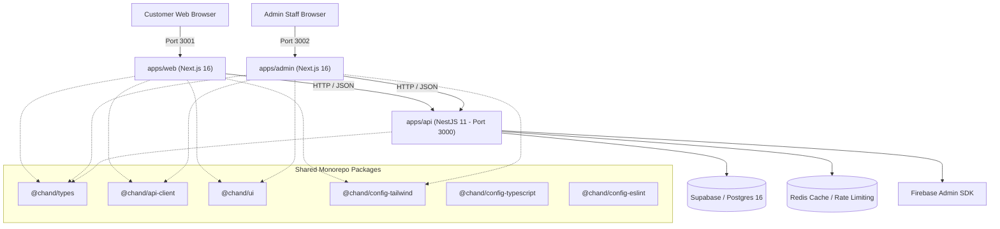

# 📱 Chand Mobile Expert Monorepo

> Production-grade full-stack monorepo for Chand Mobile Expert: mobile phone repair, certified refurbished smartphones, and accessories commerce platform based in Sambhal, UP, India.

---

## 🏛 Architecture Diagram



---

## 🚀 Quickstart in 5 Commands

```bash
# 1. Clone repository
git clone <repo-url> && cd chandmobileexpert

# 2. Install pnpm dependencies
pnpm install

# 3. Setup local database & cache (Docker)
docker compose up -d

# 4. Generate Prisma client & run database seed
pnpm db:generate
pnpm db:migrate

# 5. Start all apps in Turborepo development mode
pnpm dev
```

* **Customer Web:** [http://localhost:3001](http://localhost:3001)
* **Admin Dashboard:** [http://localhost:3002](http://localhost:3002)
* **Backend API:** [http://localhost:3000](http://localhost:3000)

---

## 📦 Workspace Layout

```
chandmobileexpert/
├── apps/
│   ├── api/                 # NestJS 11 + Prisma ORM + PostgreSQL + Firebase Admin
│   ├── web/                 # Next.js 16 Customer Platform (Three.js 3D, Leaflet map, UPI checkout)
│   └── admin/               # Next.js 16 TailAdmin Management Portal
├── packages/
│   ├── types/               # Single source of truth: Zod schemas, enums, DTOs, money utilities
│   ├── api-client/          # Shared typed Axios client with JWT refresh & error normalization
│   ├── ui/                  # Shared design system components (Button, StatusPill, Card, Price)
│   ├── config-tailwind/     # CSS @theme design tokens (vibrant lime primary #a8d946)
│   ├── config-typescript/   # Shared tsconfig bases
│   └── config-eslint/       # Shared ESLint configuration
├── infra/                   # Multi-stage production Dockerfiles
├── docs/                    # Architecture audit, decision records, runbooks
├── docker-compose.yml       # Local dev: Postgres 16, Redis 7, Mailpit
└── turbo.json               # High-performance pipeline execution
```

---

## 📜 Available Scripts

| Command | Purpose |
| :--- | :--- |
| `pnpm dev` | Starts all apps in parallel using Turborepo |
| `pnpm build` | Builds all packages and applications |
| `pnpm lint` | Runs ESLint across all workspaces |
| `pnpm typecheck` | Runs TypeScript compilation verification across all workspaces |
| `pnpm test` | Runs unit tests across all applications |
| `pnpm db:generate` | Generates the Prisma client |
| `pnpm db:migrate` | Runs database migrations |
| `pnpm db:seed` | Seeds database with initial administrative accounts & catalog data |
| `pnpm db:studio` | Opens visual Prisma Studio database manager |
| `pnpm clean` | Cleans up all build artifacts and node_modules |

